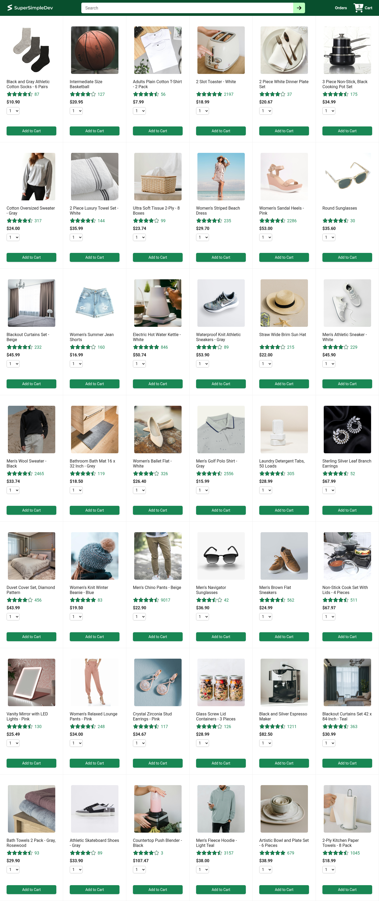
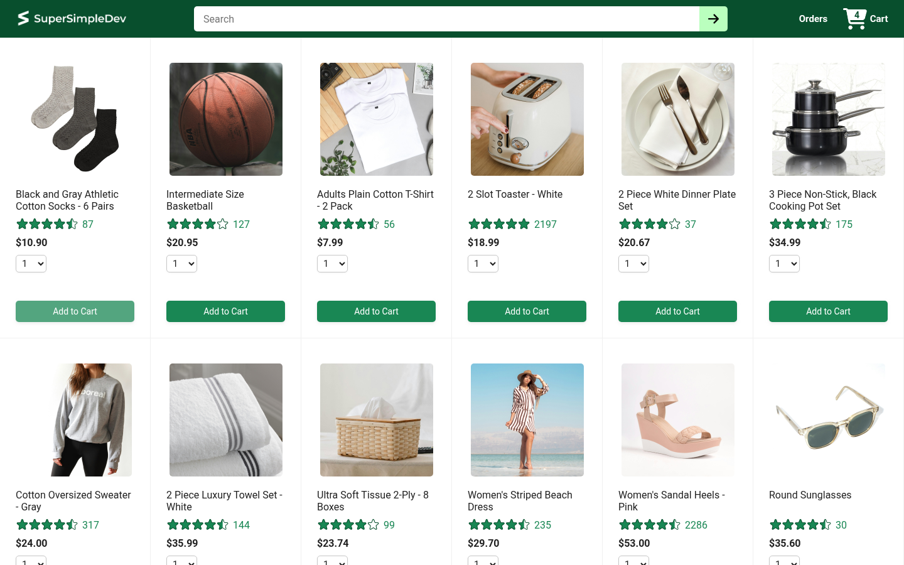
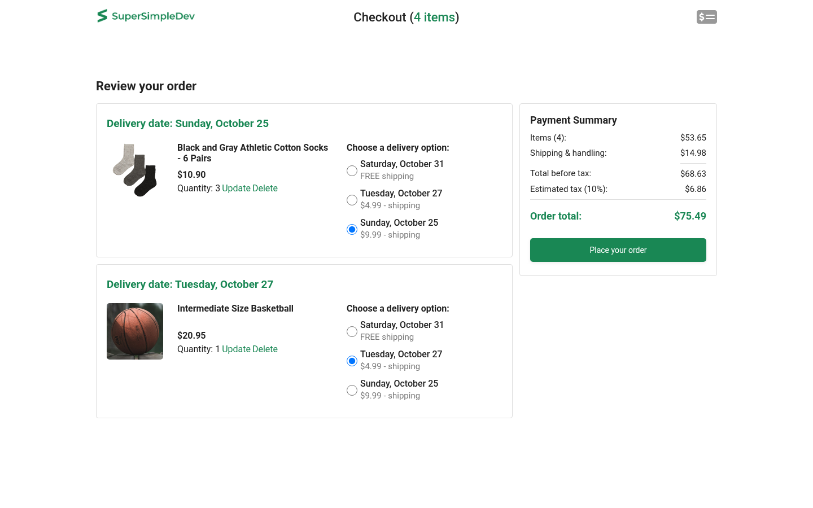
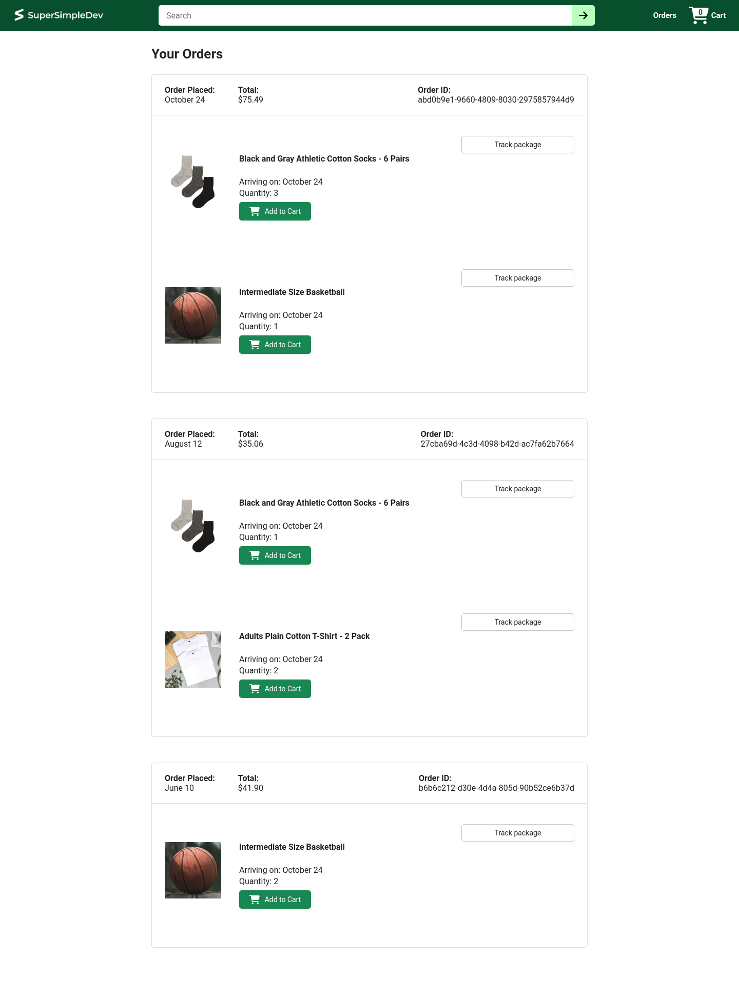
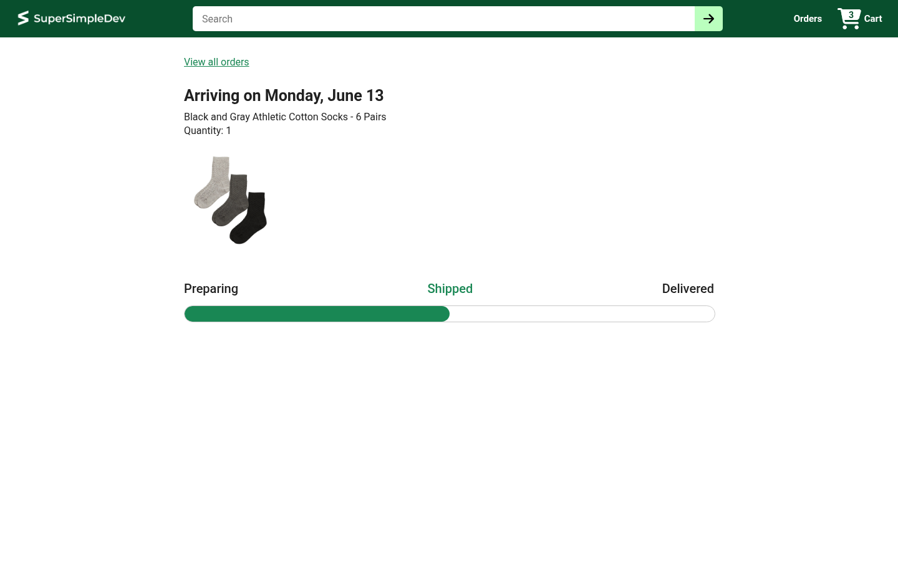
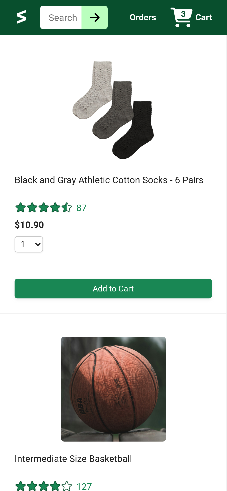
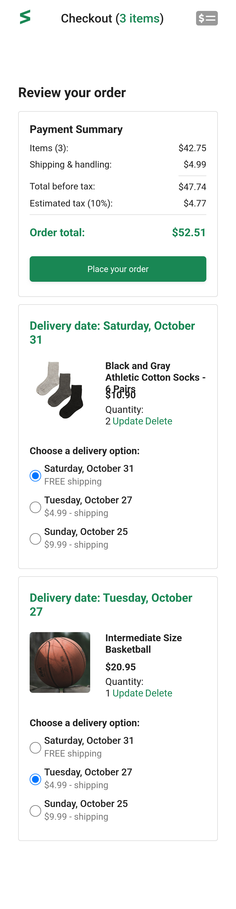
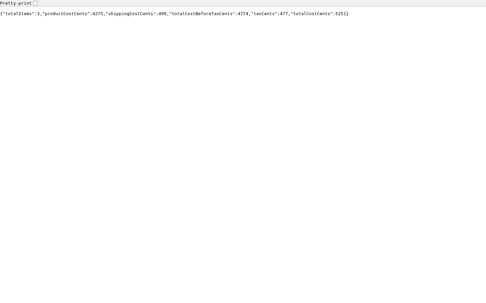
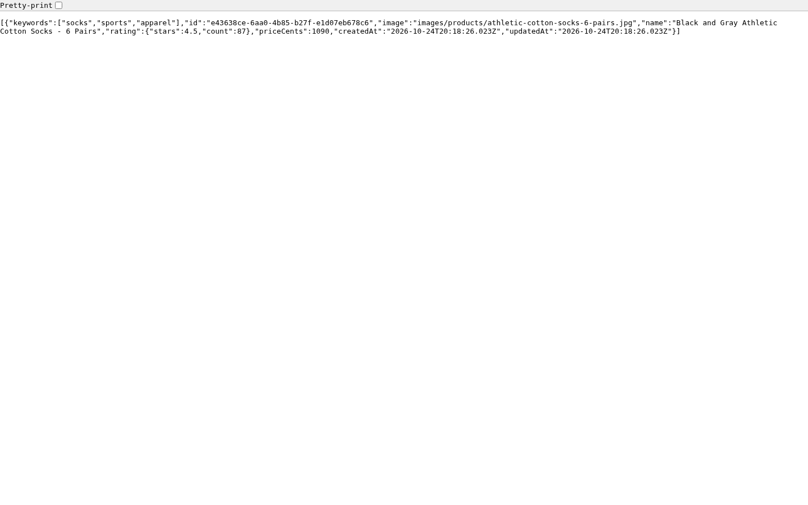

<p align="center">
  
</p>

<h1 align="center">🛒 Ecommerce Project</h1>

<p align="center">
  <b>Полнофункциональный учебный интернет-магазин</b><br>
  React 19 + Vite · Express · Sequelize · SQLite
</p>

<p align="center">
  
  
  
  
  
  
</p>

---

## 📖 Содержание

1. [О проекте](#-о-проекте)
2. [Возможности](#-возможности)
3. [Скриншоты](#-скриншоты)
4. [Архитектура](#-архитектура)
5. [Технологический стек](#-технологический-стек)
6. [Структура проекта](#-структура-проекта)
7. [Быстрый старт](#-быстрый-старт)
8. [REST API](#-rest-api)
9. [Модель данных](#-модель-данных)
10. [Пользовательский сценарий](#-пользовательский-сценарий)
11. [Известные особенности и исправления](#️-известные-особенности-и-исправления)
12. [Тестирование](#-тестирование)
13. [Полезные материалы](#-полезные-материалы)

---

## 📝 О проекте

**Ecommerce Project** — это полнофункциональный интернет-магазин, построенный по классической
client-server архитектуре:

- **`ecommerce-frontend/`** — SPA-приложение на **React 19** (сборщик **Vite 6**, маршрутизация **react-router 7**);
- **`ecommerce-backend/`** — REST API на **Express 4** с ORM **Sequelize 6** и базой данных **SQLite** (через `sql.js`).

Магазин содержит **42 товара** (одежда, обувь, аксессуары, товары для дома и техника), поддерживает
корзину, выбор вариантов доставки, оформление заказов и просмотр истории заказов.

Проект создан на основе учебного курса
[SuperSimpleDev «Ecommerce Project»](https://github.com/SuperSimpleDev/ecommerce-project)
и отлично подходит для изучения связки **React + REST API + SQL**.

---

## ✨ Возможности

| Категория | Что умеет приложение |
|---|---|
| 🏠 **Каталог** | Витрина из 42 товаров: фото, название, рейтинг (звёзды + количество отзывов), цена, выбор количества (1–10) |
| 🛒 **Корзина** | Добавление товаров со счётчиком в шапке, изменение количества, удаление товаров |
| 🚚 **Доставка** | 3 варианта: 7 дней (бесплатно), 3 дня ($4.99), 1 день ($9.99); дата доставки рассчитывается автоматически |
| 💳 **Оформление заказа** | Payment Summary: товары + доставка + налог 10% = итог; создание заказа одним кликом |
| 📦 **Заказы** | История заказов: дата, сумма, ID заказа, список товаров, кнопки «Add to Cart» (купить снова) и «Track package» |
| 📍 **Отслеживание** | Статическая демо-страница трекинга с прогресс-баром (Preparing → Shipped → Delivered) |
| 🔎 **Поиск (API)** | Бэкенд-поиск по названию и ключевым словам: `GET /api/products?search=sock` |
| 🔄 **Сброс данных** | Возврат БД к исходному состоянию: `POST /api/reset` |
| 📱 **Адаптивность** | Полностью адаптивная вёрстка: мобильная/десктопная версии (медиазапросы CSS) |

---

## 📸 Скриншоты

### 1. Главная страница — витрина товаров

Каталог всех товаров: изображение, название, рейтинг, цена, селектор количества и кнопка «Add to Cart».
В шапке — логотип, строка поиска, ссылки на **Orders** и **Cart** (со счётчиком товаров).

<p align="center">
  
</p>

*Главная страница (десктоп, 1440px) — все 42 товара подгружаются из `GET /api/products`.*

---

### 2. Добавление товара в корзину

После нажатия **«Add to Cart»** запрос `POST /api/cart-items` добавляет товар на сервер,
а счётчик на иконке корзины в шапке мгновенно обновляется (в примере: 3 → 4 товара).

<p align="center">
  
</p>

*Товар добавлен — бейдж корзины показывает «4».*

---

### 3. Страница оформления заказа (Checkout)

Слева — каждый товар корзины: дата доставки, фото, цена, количество, ссылки **Update / Delete**
и выбор варианта доставки (radio). Справа — **Payment Summary** с расчётом:
товары + доставка + налог 10% и кнопка **«Place your order»**.

<p align="center">
  
</p>

*Checkout с двумя товарами в корзине (3 + 1 шт.) и payment summary.*

---

### 4. Выбор варианта доставки

Клик по radio-кнопке отправляет `PUT /api/cart-items/:productId` с новым `deliveryOptionId`:
дата доставки пересчитывается, а стоимость доставки обновляется в Payment Summary.

<p align="center">
  
</p>

*Выбрана доставка за 1 день ($9.99) — дата изменилась на «Sunday, October 25».*

---

### 5. История заказов

После нажатия **«Place your order»** создаётся заказ (`POST /api/orders`), корзина очищается,
и выполняется переход на страницу **Orders**. Каждый заказ содержит: дату, сумму, ID,
товары с датой прибытия, кнопки «Add to Cart» и «Track package».

<p align="center">
  
</p>

*Только что созданный заказ отображается первым, ниже — два заказа из стартовых данных.*

---

### 6. Отслеживание посылки (Tracking)

Демо-страница трекинга: ссылка «View all orders», ожидаемая дата прибытия, информация о товаре
и прогресс-бар со статусами **Preparing → Shipped → Delivered**.

<p align="center">
  
</p>

---

### 7. Мобильная версия

Приложение полностью адаптивно: на мобильных переключается компактный логотип,
сетка товаров становится одноколоночной, checkout — вертикальным.

<p align="center">
  
  &nbsp;&nbsp;
  
</p>

*Слева — главная на iPhone (сетка в одну колонку), справа — мобильный checkout.*

---

### 8. REST API в действии

Все данные приложение получает из JSON API. Ответы можно посмотреть прямо в браузере:

<p align="center">
  
</p>

*`GET /api/payment-summary` — расчёт стоимости корзины на сервере.*

<p align="center">
  
</p>

*`GET /api/products?search=sock` — серверный поиск по названию и ключевым словам.*

---

## 🏗 Архитектура

Проект построен по классической двухзвенной схеме **SPA + REST API**:

```
┌─────────────────────────────┐         ┌──────────────────────────────────┐
│      ecommerce-frontend     │  HTTP   │        ecommerce-backend         │
│   (React 19 + Vite, :5173)  │ ──────► │      (Express 4, :3000)          │
│                             │  JSON   │                                  │
│  ┌───────────────────────┐  │         │  ┌────────────────────────────┐  │
│  │  Pages                │  │         │  │  Routes (REST API)         │  │
│  │  • HomePage           │  │         │  │  • /api/products           │  │
│  │  • CheckoutPage       │  │         │  │  • /api/delivery-options   │  │
│  │  • OrdersPage         │  │         │  │  • /api/cart-items         │  │
│  │  • TrackingPage       │  │         │  │  • /api/orders             │  │
│  └───────────────────────┘  │         │  │  • /api/payment-summary    │  │
│  ┌───────────────────────┐  │         │  │  • /api/reset              │  │
│  │  Global state (App)   │  │         │  └────────────┬───────────────┘  │
│  │  cart + loadCart()    │  │         │               │ Sequelize ORM    │
│  └───────────────────────┘  │         │  ┌────────────▼───────────────┐  │
│                             │         │  │  SQLite (sql.js)           │  │
│  Vite dev-proxy:            │         │  │  файл database.sqlite      │  │
│  /api, /images → :3000      │         │  └────────────────────────────┘  │
└─────────────────────────────┘         │  + static /images (товары)      │
                                        └──────────────────────────────────┘
```

**Ключевые решения:**

- **Vite dev-proxy.** Фронтенд обращается к API по относительным путям (`/api/...`), а Vite в dev-режиме
  проксирует запросы на бэкенд (`vite.config.js` → `server.proxy`). CORS настраивать не нужно.
- **Глобальное состояние корзины.** Массив `cart` живёт в `App.jsx` и передаётся в страницы через props
  вместе с функцией `loadCart()` — после любого изменения (add/update/delete) корзина перезагружается
  с сервера, и счётчик в шапке обновляется.
- **«Толстый» бэкенд.** Расчёт дат доставки, налога (10%) и итоговой суммы заказа выполняется
  **на сервере** (`/api/payment-summary`, `POST /api/orders`) — фронтенд только отображает данные.
- **SQLite без нативных зависимостей.** БД работает через `sql.js` (WebAssembly) + патч
  `patch-package`, который сохраняет состояние в файл `database.sqlite` после каждой записи.
  Нативный SQLite устанавливать не нужно — проект запускается на любой ОС.
- **Стартовые данные.** При первом запуске (пустая БД) сервер автоматически наполняет базу:
  42 товара, 3 варианта доставки, 2 товара в корзине и 2 демо-заказа.

---

## 🧰 Технологический стек

### Frontend (`ecommerce-frontend/`)

| Технология | Версия | Назначение |
|---|---|---|
| [React](https://react.dev) | 19 | UI-библиотека (функциональные компоненты, хуки) |
| [Vite](https://vite.dev) | 6 | Сборщик и dev-сервер (HMR), проксирование `/api` и `/images` |
| [react-router](https://reactrouter.com) | 7 | Клиентская маршрутизация (`/`, `/checkout`, `/orders`, `/tracking`) |
| [axios](https://axios-http.com) | 1.x | HTTP-клиент для запросов к REST API |
| [dayjs](https://day.js.org) | 1.x | Форматирование дат доставки («Sunday, October 25») |
| [Vitest](https://vitest.dev) + Testing Library | — | Юнит- и компонентные тесты |

### Backend (`ecommerce-backend/`)

| Технология | Версия | Назначение |
|---|---|---|
| [Express](https://expressjs.com) | 4 | HTTP-сервер и REST API |
| [Sequelize](https://sequelize.org) | 6 | ORM: модели Product, CartItem, DeliveryOption, Order |
| [sql.js](https://sql.js.org) + [sql.js-as-sqlite3](https://www.npmjs.com/package/sql.js-as-sqlite3) | 1.10 / 0.2 | SQLite на WebAssembly (без нативной сборки) |
| [patch-package](https://www.npmjs.com/package/patch-package) | 8 | Патч: сохранение БД в файл `database.sqlite` |
| cors | 2.8 | Разрешение кросс-доменных запросов |
| mysql2 / pg | — | Драйверы для подключения к внешней БД (MySQL/PostgreSQL, через переменные `RDS_*`) |

> 💡 **Поддержка внешней БД.** Если заданы переменные окружения `RDS_HOSTNAME`,
> `RDS_USERNAME`, `RDS_PASSWORD` (AWS RDS), Sequelize автоматически переключится с SQLite
> на MySQL/PostgreSQL (`models/index.js`).

---

## 📁 Структура проекта

```
Ecommerce-project-main/
├── ecommerce-frontend/               # React-приложение (SPA)
│   ├── index.html                    # HTML-шаблон (шрифт Roboto)
│   ├── vite.config.js                # Vite: плагин React + proxy /api и /images
│   ├── vitest.config.js              # Конфиг тестов (jsdom + Testing Library)
│   ├── public/
│   │   └── images/                   # Статика: товары, иконки, рейтинги, логотипы
│   └── src/
│       ├── main.jsx                  # Точка входа: BrowserRouter + App
│       ├── App.jsx                   # Маршруты + глобальное состояние корзины
│       ├── components/
│       │   └── Header.jsx            # Шапка: логотип, поиск, Orders, Cart (счётчик)
│       ├── pages/
│       │   ├── home/                 # Главная: HomePage → ProductsGrid → ProductContainer
│       │   ├── checkout/             # Checkout: шапка, OrderSummary (CartItemDetails,
│       │   │                         #   DeliveryOptions, DeliveryDate), PaymentSummary
│       │   ├── orders/               # Заказы: OrdersPage → OrdersGrid → OrderHeader,
│       │   │                         #   OrderDetailsGrid (Buy again / Track package)
│       │   └── tracking/             # Трекинг: прогресс-бар (демо)
│       ├── utils/formatMoney.js      # formatMoney(1090) → "$10.90"
│       └── data/, backend/           # Локальные копии данных (для оффлайн-разработки)
│
├── ecommerce-backend/                # Express API + база данных
│   ├── server.js                     # Точка входа: middleware, маршруты, автосидинг БД
│   ├── models/
│   │   ├── index.js                  # Подключение Sequelize (SQLite / RDS) + хук сохранения
│   │   ├── Product.js                # Модель товара (UUID, image, rating, priceCents…)
│   │   ├── CartItem.js               # Элемент корзины (productId, quantity, deliveryOptionId)
│   │   ├── DeliveryOption.js         # Вариант доставки (deliveryDays, priceCents)
│   │   └── Order.js                  # Заказ (orderTimeMs, totalCostCents, products JSON)
│   ├── routes/                       # REST-маршруты:
│   │   ├── products.js               #   GET /api/products (поиск ?search=)
│   │   ├── deliveryOptions.js        #   GET /api/delivery-options (?expand=)
│   │   ├── cartItems.js              #   GET/POST/PUT/DELETE /api/cart-items
│   │   ├── orders.js                 #   GET/POST /api/orders (?expand=products)
│   │   ├── paymentSummary.js         #   GET /api/payment-summary
│   │   └── reset.js                  #   POST /api/reset (сброс БД)
│   ├── defaultData/                  # Стартовые данные: 42 товара, корзина, заказы
│   ├── images/                       # Картинки товаров, иконки, логотипы
│   ├── patches/                      # Патч sql.js-as-sqlite3 (сохранение в файл)
│   ├── documentation.md              # Оригинальная документация API (EN)
│   ├── troubleshooting.md            # Инструкция по решению проблем
│   └── exercise-solutions/           # Решения упражнений курса (1a–1e)
│
└── screenshots/                      # Скриншоты для этого README
```

---

## 🚀 Быстрый старт

### Предварительные требования

- **Node.js 22+** ([скачать](https://nodejs.org/))
- npm (идёт в комплекте с Node.js)

### 1. Запуск бэкенда

```bash
cd ecommerce-backend
npm install        # установит зависимости и применит патч (patch-package)
npm run dev        # запуск через nodemon (авто-перезапуск)
# или: npm start / node server.js
```

После старта в консоли появится:

```
Loaded fresh db
Default data added to the database.
Server is running on port 3000
```

> Порт по умолчанию — **3000** (меняется переменной окружения `PORT`).
> При первом запуске база автоматически наполняется стартовыми данными
> и создаётся файл `database.sqlite`.

### 2. Запуск фронтенда

В **новом терминале**:

```bash
cd ecommerce-frontend
npm install
npm run dev
```

```
  VITE v6.x  ready in XXX ms
  ➜  Local:   http://localhost:5173/
```

Откройте **http://localhost:5173** — магазин готов к работе. 🎉

> 💡 **Если бэкенд запущен на другом порту**, укажите его через переменную окружения:
> ```bash
> PORT=3001 node server.js                  # бэкенд на 3001 (в папке ecommerce-backend)
> BACKEND_PORT=3001 npm run dev             # фронтенд проксирует на 3001
> ```

### 3. Сборка для продакшена (опционально)

```bash
cd ecommerce-frontend
npm run build        # соберёт SPA в ecommerce-backend/dist
```

После сборки Express сам раздаёт фронтенд из `dist/` — достаточно запустить
один только бэкенд и открыть `http://localhost:3000`.

### Полезные команды

| Команда | Где | Описание |
|---|---|---|
| `npm run dev` | frontend / backend | Dev-режим (Vite HMR / nodemon) |
| `npm run lint` | frontend | ESLint |
| `npx vitest run` | frontend | Запуск тестов |
| `npm start` | backend | Прод-режим без nodemon |
| `curl -X POST http://localhost:3000/api/reset` | — | Сброс БД к стартовым данным |

---

## 🌐 REST API

Базовый URL: `http://localhost:3000/api`

### Товары и доставка

| Метод | Путь | Описание |
|---|---|---|
| `GET` | `/products` | Список всех товаров (42 шт.) |
| `GET` | `/products?search=sock` | Поиск по названию/ключевым словам (без учёта регистра) |
| `GET` | `/delivery-options` | Варианты доставки |
| `GET` | `/delivery-options?expand=estimatedDeliveryTime` | …с рассчитанным временем доставки |

**Пример ответа `GET /api/products`** (сокращённо):

```json
[
  {
    "id": "e43638ce-6aa0-4b85-b27f-e1d07eb678c6",
    "image": "images/products/athletic-cotton-socks-6-pairs.jpg",
    "name": "Black and Gray Athletic Cotton Socks - 6 Pairs",
    "rating": { "stars": 4.5, "count": 87 },
    "priceCents": 1090,
    "keywords": ["socks", "sports", "apparel"]
  }
]
```

### Корзина

| Метод | Путь | Описание |
|---|---|---|
| `GET` | `/cart-items` | Содержимое корзины |
| `GET` | `/cart-items?expand=product` | …с полными данными товаров |
| `POST` | `/cart-items` | Добавить товар `{ productId, quantity: 1–10 }` (если товар уже есть — количество суммируется) |
| `PUT` | `/cart-items/:productId` | Изменить `quantity` и/или `deliveryOptionId` |
| `DELETE` | `/cart-items/:productId` | Удалить товар из корзины |

**Пример — добавить товар:**

```bash
curl -X POST http://localhost:3000/api/cart-items \
  -H "Content-Type: application/json" \
  -d '{"productId": "e43638ce-6aa0-4b85-b27f-e1d07eb678c6", "quantity": 2}'
```

### Заказы

| Метод | Путь | Описание |
|---|---|---|
| `GET` | `/orders` | Все заказы (новые первыми) |
| `GET` | `/orders?expand=products` | …с полными данными товаров |
| `GET` | `/orders/:orderId` | Конкретный заказ |
| `POST` | `/orders` | Создать заказ из текущей корзины: считает стоимость, налог 10%, очищает корзину |

### Расчёт и служебные

| Метод | Путь | Описание |
|---|---|---|
| `GET` | `/payment-summary` | Расчёт корзины: `totalItems`, `productCostCents`, `shippingCostCents`, `taxCents` (10%), `totalCostCents` |
| `POST` | `/reset` | Полный сброс БД к стартовым данным (204) |

**Пример ответа `GET /api/payment-summary`:**

```json
{
  "totalItems": 3,
  "productCostCents": 4275,
  "shippingCostCents": 499,
  "totalCostBeforeTaxCents": 4774,
  "taxCents": 477,
  "totalCostCents": 5251
}
```

> Все суммы передаются **в центах**. Для отображения используется хелпер
> `formatMoney(cents)` → `$${(cents / 100).toFixed(2)}`.

---

## 🗄 Модель данных

### `Product` — товар

| Поле | Тип | Описание |
|---|---|---|
| `id` | UUID (PK) | Автогенерация `UUIDV4` |
| `image` | STRING | Путь к картинке (`images/products/…`) |
| `name` | STRING | Название |
| `rating` | JSON | `{ stars: 0–5, count: число отзывов }` |
| `priceCents` | INTEGER | Цена в центах |
| `keywords` | STRING→массив | Ключевые слова для поиска (хранятся строкой, геттер/сеттер превращают в массив) |

### `CartItem` — элемент корзины

| Поле | Тип | Описание |
|---|---|---|
| `productId` | UUID (FK→Product) | Товар |
| `quantity` | INTEGER | Количество (1–10) |
| `deliveryOptionId` | STRING (FK→DeliveryOption) | Выбранный вариант доставки (по умолчанию `"1"`) |

### `DeliveryOption` — вариант доставки

| `id` | `deliveryDays` | `priceCents` |
|---|---|---|
| `"1"` | 7 | 0 (FREE) |
| `"2"` | 3 | 499 ($4.99) |
| `"3"` | 1 | 999 ($9.99) |

### `Order` — заказ

| Поле | Тип | Описание |
|---|---|---|
| `id` | UUID (PK) | Автогенерация |
| `orderTimeMs` | BIGINT | Время создания (мс) |
| `totalCostCents` | INTEGER | Итог с налогом: `round((товары + доставка) × 1.1)` |
| `products` | JSON | Снимок корзины: `[{ productId, quantity, estimatedDeliveryTimeMs }]` |

---

## 🔄 Пользовательский сценарий

```
 Главная              Checkout                    Orders               Tracking
┌──────────┐   POST /api/cart-items  ┌──────────┐  POST /api/orders  ┌──────────┐
│ Выбрать  │ ──────────────────────► │ Проверить│ ─────────────────► │ История  │
│ товар и  │                         │ корзину, │                    │ заказов, │
│ кол-во   │                         │ выбрать  │                    │ «купить  │──► Track
│ (1–10)   │                         │ доставку │                    │ снова»   │    package
└──────────┘                         └──────────┘                    └──────────┘
      ▲                                     │
      │        счётчик корзины обновляется  │ корзина очищается
      └─────────────────────────────────────┘ после оформления заказа
```

1. На главной пользователь выбирает количество товара (select 1–10) и жмёт **Add to Cart** —
   счётчик в шапке обновляется.
2. На **Checkout** пользователь видит корзину, меняет варианты доставки (даты пересчитываются),
   может удалить товар и видит итоговый расчёт с налогом 10%.
3. **Place your order** → сервер создаёт заказ (снимок корзины + расчёт), очищает корзину
   и редиректит на **Orders**.
4. На странице заказов можно **купить товар снова** (вернуть в корзину) или перейти к **трекингу**.

---

## ⚠️ Известные особенности и исправления

### Исправлено в этой версии

**1. Краш страницы Tracking (исправлено).**
В исходном коде `TrackingPage` рендерил `<Header />` **без пропса `cart`**, из-за чего
`cart.forEach(...)` падал с `TypeError: Cannot read properties of undefined (reading 'forEach')`
и страница отображалась пустой. Исправление:

```diff
  // App.jsx
- <Route path="tracking" element={<TrackingPage />} />
+ <Route path="tracking" element={<TrackingPage cart={cart} />} />

  // TrackingPage.jsx
- export function TrackingPage() {
-   ...
-   <Header />
+ export function TrackingPage({ cart }) {
+   ...
+   <Header cart={cart} />
```

**2. Настраиваемый порт бэкенда.**
В `vite.config.js` адрес прокси вынесен в переменную окружения
(`BACKEND_PORT`, по умолчанию `3000`) — поведение по умолчанию не изменилось.

### Особенности текущей реализации

- **Строка поиска в шапке** пока не подключена к API (декоративная). Поиск работает на уровне
  бэкенда: `GET /api/products?search=…` — легко подключить.
- **Ссылка «Update»** в корзине пока только перезагружает корзину с сервера
  (изменение количества доступно через `PUT /api/cart-items/:productId`).
- **Страница Tracking** — статическая демо-заглушка (данные захардкожены), прогресс-бар
  не привязан к реальному статусу заказа.
- **React-предупреждения**: в `OrderSummary`, `DeliveryOptions` и `OrdersGrid` списки
  рендерятся без ключа на корневом `<>` Fragment (ключ стоит на вложенном `div`).
  На работу не влияет, но лучше перенести `key` на `<Fragment key=…>`.
- Товар **добавляется в корзину повторно** с суммированием количества, а количество ограничено
  диапазоном 1–10 (валидируется на сервере).

---

## 🧪 Тестирование

Во фронтенде настроен **Vitest** + **Testing Library** + **jsdom**:

```bash
cd ecommerce-frontend
npx vitest run     # одноразовый прогон
npx vitest         # watch-режим
```

Тесты в проекте:

| Файл | Что проверяет |
|---|---|
| `src/utils/formatMoney.test.js` | Форматирование цен (`1090 → $10.90`) |
| `src/pages/home/HomePage.test.jsx` | Рендер главной страницы |
| `src/pages/home/ProductContainer.test.jsx` | Карточка товара, добавление в корзину (мок axios) |

---

## 📚 Полезные материалы

- 📄 [`ecommerce-backend/documentation.md`](ecommerce-backend/documentation.md) — оригинальная документация API (EN)
- 🔧 [`ecommerce-backend/troubleshooting.md`](ecommerce-backend/troubleshooting.md) — что делать при ошибках
- ✅ [`ecommerce-backend/exercise-solutions/`](ecommerce-backend/exercise-solutions/) — решения упражнений (1a–1e)
- 🎬 Видео-туториал курса: [Part 1 — Create the Backend](https://youtu.be/vBprybSmJs8)
- 📦 Исходный курс: [SuperSimpleDev/ecommerce-project](https://github.com/SuperSimpleDev/ecommerce-project)
- 🖥 `ecommerce-frontend/starting-code/` — стартовый HTML/CSS код урока

---

<p align="center">
  Сделано на основе курса <a href="https://github.com/SuperSimpleDev">SuperSimpleDev</a> ·
  README подготовлен с реальными скриншотами работающего приложения
</p>
